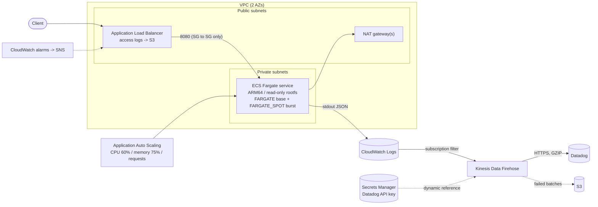
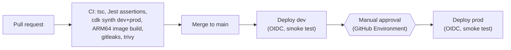

# ecs-fargate-platform

[](https://github.com/devid9602/ecs-fargate-platform/actions/workflows/ci.yml)


A production-style container platform on **AWS ECS Fargate**, defined entirely in **AWS CDK (TypeScript)**: multi-AZ networking, an ALB in front of a Graviton Spot/on-demand task mix, target-tracking autoscaling, alarms, **CloudWatch Logs -> Firehose -> Datadog** log delivery, and keyless **GitHub Actions -> AWS (OIDC)** deployments with a gated dev -> prod promotion.

The sample application is deliberately trivial. The infrastructure, the operational defaults, and the reasoning behind them are the point. Every non-obvious choice is explained in [docs/decisions.md](docs/decisions.md).

## Architecture





## What's in it

| Area | Details |
|---|---|
| **Stacks** | `network` -> `cluster` -> `logging` -> `service` per environment, split by change frequency and blast radius |
| **Environments** | `dev` (1 NAT, 100% Spot, tiny tasks) and `prod` (NAT per AZ, on-demand floor + Spot burst, deletion protection, 30-day logs), selected with `-c env=` |
| **Compute** | Fargate on **ARM64**, read-only root filesystem, non-root user, init process, container health check |
| **Cost (FinOps)** | Graviton, Spot mix with on-demand floor, S3 gateway endpoint, per-env NAT count, REJECT-only flow logs, log retention per env. See [docs/cost.md](docs/cost.md) |
| **Reliability** | Zero-downtime rollouts (`minHealthy 100%`), deployment circuit breaker with rollback, graceful SIGTERM drain, tuned keep-alive/deregistration/stop timeouts |
| **Autoscaling** | Target tracking on CPU, memory and ALB requests per target, with asymmetric cooldowns |
| **Observability** | JSON logs, Container Insights, ALB access logs, 5 alarms (ELB 5xx, target 5xx, unhealthy hosts, CPU, memory) to SNS, Firehose -> Datadog |
| **Security** | Tasks only reachable from the ALB security group, no public IPs, TLS listener + redirect when a certificate is supplied, encrypted buckets with SSL enforced, no static AWS keys, secret never in the template |
| **CI/CD** | GitHub Actions with OIDC, reusable deploy workflow, environment-gated prod, smoke tests, dev teardown workflow with typed confirmation |
| **Testing** | Jest assertions on the synthesized CloudFormation (spot mix, circuit breaker, no open ingress, NAT counts, OIDC trust scope, ...) and a unit test for the app |
| **Runbook** | [ALB 502/504 troubleshooting](docs/runbooks/502-504-troubleshooting.md) |

## Quick start

Prerequisites: Node 22+, Docker with buildx (ARM64 image), AWS credentials for a sandbox account.

```bash
make install                      # npm install (or npm ci once a lockfile is committed)
make test                         # type-check, CDK assertion tests, sample-app tests
npm run synth:dev                 # no AWS credentials needed

make bootstrap ACCOUNT=<id> REGION=us-east-1   # once per account/region
npm run deploy:dev                # deploys network, cluster, logging, service
```

The `ServiceUrl` output is the ALB address; `curl "$ServiceUrl/healthz"` should return `{"status":"ok"}`.

### Optional context flags

| Flag | Effect |
|---|---|
| `-c env=prod` | Select the prod profile |
| `-c certificateArn=arn:aws:acm:...` | HTTPS listener (TLS 1.2+ policy) and HTTP -> HTTPS redirect |
| `-c alarmEmail=you@example.com` | Subscribe an email address to the alarm topic |
| `-c datadog=true` | Enable the Datadog pipeline in dev (always on in prod) |
| `-c datadogSite=datadoghq.eu` | Datadog region |

### Datadog log delivery

Create the secret once per environment (the value is the plain API key), then deploy:

```bash
aws secretsmanager create-secret --name ecs-platform/prod/datadog-api-key --secret-string "<DATADOG_API_KEY>"
```

## GitHub Actions setup (keyless)

1. Deploy the OIDC role once with local credentials. Use `-c existingOidcProviderArn=...` if the account already has a GitHub OIDC provider:
   ```bash
   make oidc REPO=<owner>/ecs-fargate-platform
   ```
2. In **Settings -> Environments**, create `dev` and `prod`. Add required reviewers to `prod`.
3. Add these **variables** (not secrets) to both environments: `AWS_DEPLOY_ROLE_ARN` (stack output), `AWS_REGION`. Optional: `CERTIFICATE_ARN`, `ALARM_EMAIL`.
4. Push to `main`: CI runs, then Deploy promotes dev -> prod.

## Repository layout

```
bin/app.ts                 CDK entrypoint, picks the environment from context
lib/config.ts              Per-environment settings (the knobs: NAT count, task size, Spot weights, ...)
lib/network-stack.ts       VPC, subnets, NAT, S3 endpoint, flow logs
lib/cluster-stack.ts       ECS cluster + Fargate capacity providers
lib/logging-stack.ts       Log group + Firehose -> Datadog pipeline
lib/service-stack.ts       Task definition, service, ALB, autoscaling, alarms
lib/github-oidc-stack.ts   GitHub OIDC provider and least-privilege deploy role
lib/platform.ts            Wires the four stacks (shared by app and tests)
app/                       Dependency-free sample API (health, readiness, graceful shutdown)
test/                      CloudFormation assertion tests
docs/                      Decisions, cost model, runbook
.github/workflows/         CI, reusable deploy, promotion, dev teardown
```

## Known limitations and next steps

Being explicit about scope:

- Single region, single account per environment. A multi-account, multi-region layout (one pipeline fanning out per region) is the natural extension.
- No WAF, Route 53 or ACM automation. Bring your own certificate ARN.
- Trivy IaC scanning runs in report-only mode until findings are triaged; `cdk-nag` would be the next gate.
- Rolling deployments only; canary or blue/green traffic shifting would be the next step, still driven from GitHub Actions.
- Datadog metrics and APM (the Datadog agent sidecar or AWS integration) are out of scope; this repo covers log delivery.

## License

MIT
